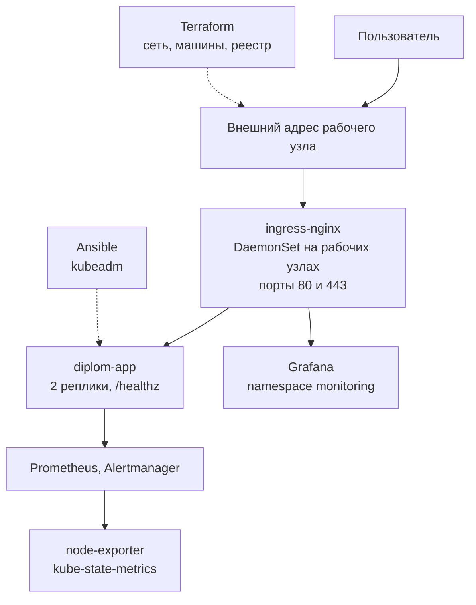
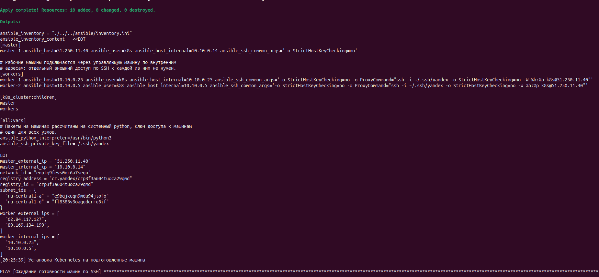
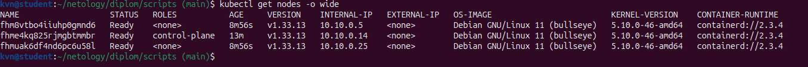
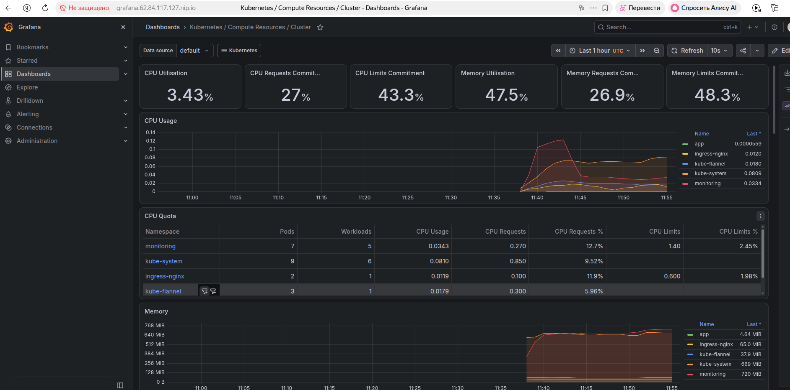
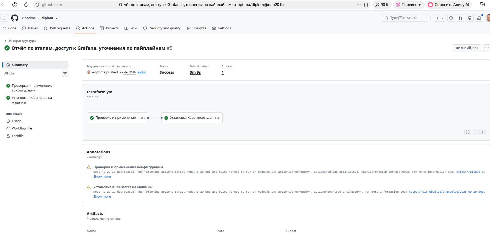
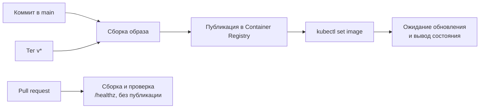
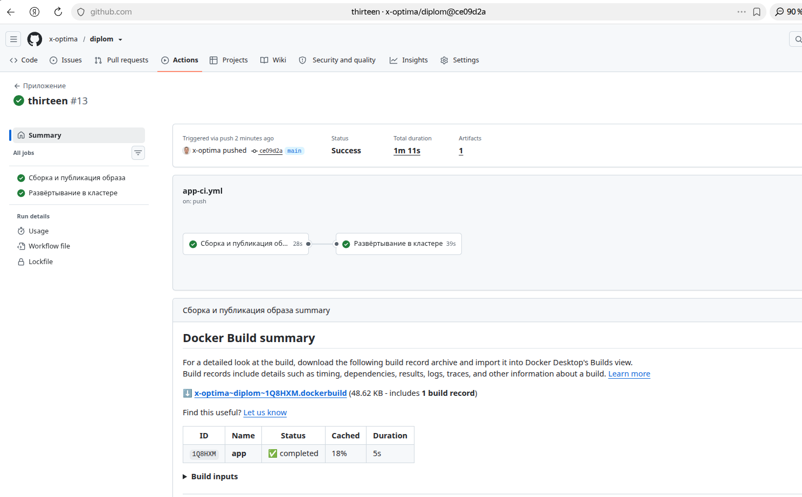
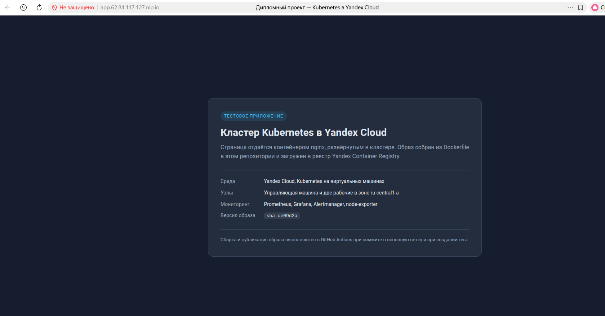

# Дипломный проект: инфраструктура, кластер Kubernetes и CI/CD в Yandex Cloud

Проект разворачивает тестовое приложение в кластере Kubernetes, собранном на
виртуальных машинах Yandex Cloud. Инфраструктура описана в Terraform,
состояние хранится в Object Storage, установка кластера выполняется через
Ansible, сборка и доставка приложения — в GitHub Actions, метрики и панели
даёт kube-prometheus-stack.

## Архитектура



Три машины в одной зоне доступности: управляющая и две рабочие. Контроллер
ingress занимает порты 80 и 443 на рабочих узлах, поэтому внешним адресом
служит адрес любого из них. Приложение и Grafana публикуются через один
контроллер по разным именам хостов.

## Состав решения

| Компонент | Реализация |
|---|---|
| Облачная сеть | VPC `10.10.0.0/16`, подсети `/24` в зонах `ru-central1-a` и `ru-central1-d` |
| Кластер | собственный кластер на трёх машинах, установка через kubeadm и Ansible |
| Управляющая машина | `standard-v3`, 2 ядра, 2 ГБ, диск 4 ГБ HDD, доля процессора 20 %, не прерывается |
| Рабочие машины | две прерываемые машины `standard-v3`, 2 ядра, 2 ГБ, диск 7 ГБ HDD |
| Хранилище состояния | бакет Object Storage со случайным суффиксом в имени, backend S3 с версионированием |
| Реестр образов | Yandex Container Registry |
| Приложение | nginx со статической страницей, образ на базе `nginx:1.27-alpine` |
| Входной трафик | ingress-nginx на портах 80 и 443 каждой машины |
| Мониторинг | kube-prometheus-stack: Prometheus, Grafana, Alertmanager, node-exporter, kube-state-metrics |
| CI/CD | GitHub Actions: сборка образа, релиз по тегу, деплой, план Terraform |

## Структура репозитория

```
.
├── app/                         тестовое приложение и Dockerfile
├── ansible/                     инвентарь и плейбук установки кластера
├── k8s/
│   ├── app/                     Deployment, Service, Ingress, PodDisruptionBudget
│   ├── ingress-nginx/           значения Helm для входного контроллера
│   └── monitoring/              значения Helm для kube-prometheus-stack
├── terraform/
│   ├── bootstrap/               сервисные аккаунты и бакет состояния
│   ├── infrastructure/          сеть, три машины кластера, реестр образов
│   └── terraform.tfvars.example шаблон переменных обоих этапов
├── scripts/                     развёртывание и удаление ресурсов
├── .github/workflows/           пайплайны приложения и инфраструктуры
├── screenshots/                 снимки экрана для отчёта
└── README.md                    отчёт о выполнении
```

## Развёртывание

Весь проект разворачивается одной командой из корня репозитория:

```bash
./scripts/deploy.sh
```

Скрипт последовательно проходит этапы: подготовительный, инфраструктуру,
установку кластера, файл доступа, контроллер ingress, мониторинг, сборку
образа и развёртывание приложения. Повторный запуск пропускает созданное:
Terraform сообщает об отсутствии изменений, ключ доступа и `backend.hcl`
не пересоздаются, Helm обновляет выпуски.

| Этап | Аргумент | Что делает |
|---|---|---|
| Подготовительный | `bootstrap` | сервисные аккаунты, ключ, бакет состояния |
| Инфраструктура | `infra` | сеть, три машины, реестр образов |
| Кластер | `cluster` | установка Kubernetes через Ansible |
| Доступ | `kubeconfig` | файл доступа в `~/.kube/config` |
| Ingress | `ingress` | контроллер ingress-nginx |
| Мониторинг | `monitoring` | Prometheus, Grafana, Alertmanager |
| Приложение | `app` | сборка образа и развёртывание |
| Состояние | `status` | поды, сервисы, ingress |

Удаление выполняется одной командой:

```bash
./scripts/destroy.sh
```

Порядок обратный развёртыванию: релизы Helm и приложение, затем машины, сеть
и реестр, затем сервисные аккаунты и бакет с файлом состояния. Полное удаление
запрашивает подтверждение — нужно ввести слово `delete`; флаг `--yes` снимает
вопрос и обязателен при запуске без терминала. В конце печатается сводка
оставшихся в каталоге ресурсов.

## Этап 1. Облачная инфраструктура

Инфраструктура разделена на два каталога: файл состояния Terraform нельзя
хранить в бакете, которым управляет этот же файл. Подготовительный этап
выполняется один раз, после чего изменения применяются от отдельного
сервисного аккаунта.

### Сервисные аккаунты

`terraform/bootstrap` создаёт два сервисных аккаунта с ролями на уровне
каталога:

| Аккаунт | Роли | Назначение |
|---|---|---|
| `diplom-terraform` | `editor`, `storage.admin` | управление ресурсами из Terraform и пайплайна |
| `diplom-k8s-nodes` | `container-registry.images.puller`, `logging.writer`, `monitoring.editor` | загрузка образов и телеметрия с машин кластера |

Ключ сервисного аккаунта Terraform сохраняется в
`terraform/bootstrap/terraform-sa-key.json` с правами `0600` и исключён из
репозитория.

### Хранилище состояния

Подготовительный этап создаёт бакет с включённым версионированием и закрытым
анонимным доступом. Параметры подключения вынесены в
`terraform/infrastructure/backend.hcl`, который не попадает в Git. Файл
создаётся автоматически при первом запуске этапа `infra`: скрипт берёт
идентификатор сервисного аккаунта и имя бакета из выходов предыдущего этапа,
выпускает статический ключ доступа и подставляет `key_id` и `secret`
в шаблон. Закрытая часть ключа записывается в файл с правами `600`.

Версионирование бакета включается через S3 API, поэтому у сервисного
аккаунта нужна роль `storage.admin`. Роль `editor` её не заменяет. IAM-ключ
из подготовительного этапа для S3 не подходит — требуется отдельный
статический ключ доступа.

### Сеть

`terraform/infrastructure/network.tf` создаёт сеть `10.10.0.0/16`, по одной
подсети `/24` в каждой зоне и одну группу безопасности. Она разрешает SSH,
трафик внутри сети, API-сервер на порту 6443, HTTP и HTTPS на портах 80 и 443,
диапазон NodePort и исходящие соединения. Отдельная группа для балансировщика
не нужна: контроллер ingress работает на самих машинах.

### Переменные и запуск

Перед первым запуском создаётся файл `terraform/terraform.tfvars` рядом
с каталогами этапов:

```bash
cp terraform/terraform.tfvars.example terraform/terraform.tfvars
```

В него вписываются `cloud_id` и `folder_id` из `yc config list`, имя бакета,
уникальное в пределах Object Storage, и параметры машин. Скрипты передают
файл этапам через `-var-file`, отбирая только объявленные в конфигурации
этапа переменные, поэтому общий файл не вызывает предупреждений Terraform.

Путь к ключу задаётся в `service_account_key_file`. Значение по умолчанию —
`../bootstrap/terraform-sa-key.json`, ключ аккаунта `diplom-terraform`.

```bash
./scripts/deploy.sh bootstrap
./scripts/deploy.sh infra
```

#### Созданные ресурсы

Вывод `terraform apply`: сервисные аккаунты, бакет состояния с
версионированием, сеть с подсетями, три машины и реестр образов.



## Этап 2. Кластер Kubernetes

Кластер собран самостоятельно на трёх машинах. Управляемый сервис требует
загрузочный диск узла не меньше 30 ГБ, что не проходит по квоте на диски
в зоне; распределение 4 + 7 + 7 ГБ занимает 18 ГБ и укладывается в лимит.

| Параметр | Значение |
|---|---|
| Версия Kubernetes | 1.33, установка через kubeadm |
| Образ машин | Debian 11 (`debian-11-v20260914`), минимальный диск 3 ГБ |
| Управляющая машина | `diplom-master`, зона `ru-central1-a`, не прерывается |
| Рабочие машины | `diplom-worker-1`, `diplom-worker-2`, зона `ru-central1-a`, прерываемые |
| Ресурсы машин | 2 ядра, 2 ГБ, диск HDD: 4 ГБ у управляющей, 7 ГБ у рабочих, доля процессора 20 % |
| Сеть подов | `10.244.0.0/16`, flannel |
| Доступ к API | публичный адрес управляющей машины, порт 6443 |
| Входной трафик | ingress-nginx на портах 80 и 443 каждой машины |

Плейбук `ansible/playbook-k8s.yml` отключает подкачку, включает модули
`overlay` и `br_netfilter`, настраивает параметры ядра, ставит containerd
и пакеты Kubernetes, создаёт кластер на управляющей машине и присоединяет
рабочие. На управляющей машине пакеты берутся из репозитория `pkgs.k8s.io`,
рабочим те же пакеты передаются файлами, чтобы установка не зависела
от внешнего доступа с каждой машины.

Инвентарь `ansible/inventory.ini` формирует Terraform из адресов, выданных
облаком. Рабочие машины подключаются через управляющую по внутренним адресам.

```bash
./scripts/deploy.sh cluster
./scripts/deploy.sh kubeconfig
```

В сертификат API-сервера при инициализации включается внешний адрес
управляющей машины, поэтому файл доступа работает с рабочей станции.

```bash
kubectl get nodes -o wide
kubectl get pods --all-namespaces
```

#### Состав кластера

Три узла в состоянии `Ready`, версия v1.33.13, внутренние адреса и роли.



#### Поды всех пространств имён

Поды приложения, мониторинга и системных компонентов в состоянии `Running`.


## Этап 3. Тестовое приложение

Приложение находится в каталоге `app`: статическую страницу отдаёт nginx.

| Файл | Назначение |
|---|---|
| `app/Dockerfile` | сборка образа, версия передаётся аргументом сборки |
| `app/nginx.conf` | конфигурация сервера, обработчик проверки состояния `/healthz` |
| `app/html/index.html` | страница с описанием стенда и версией образа |

Образ построен на `nginx:1.27-alpine`, каталог с содержимым принадлежит
пользователю `nginx`, добавлена проверка работоспособности контейнера. Версия
образа записывается в `/usr/share/nginx/html/version.txt` и отображается
на странице.

```bash
docker build --build-arg APP_VERSION=v1.0.0 -t cr.yandex/<идентификатор>/diplom-app:v1.0.0 app/
yc container registry configure-docker
docker push cr.yandex/<идентификатор>/diplom-app:v1.0.0
```

Адрес реестра выводится Terraform:

```bash
terraform -chdir=terraform/infrastructure output registry_address
```

Собранный образ: `cr.yandex/<идентификатор реестра>/diplom-app:latest`.
Метка `latest` обновляется при коммите в основную ветку и при выпуске тега.

В пайплайне образ получает две метки: неизменяемую (`sha-<7 символов
коммита>` либо `v1.0.0` для тега) и `latest` для основной ветки и релизов.
По неизменяемой метке можно вернуться к предыдущей версии и увидеть, из
какого коммита собран образ.

#### Страница приложения

Адрес `app.<внешний IP рабочего узла>.nip.io`, в подвале страницы — версия
образа из файла `/usr/share/nginx/html/version.txt`.


## Этап 4. Мониторинг и развёртывание приложения

### Входной контроллер

`ingress-nginx` устанавливается в отдельное пространство имён и работает как
DaemonSet: по одной реплике на каждом рабочем узле, порты 80 и 443 занимаются
напрямую. Драйвера балансировщика у собственного кластера нет, поэтому
входной адрес — внешний адрес рабочего узла. На управляющей машине стоит
taint `node-role.kubernetes.io/control-plane` с эффектом `NoSchedule`, поэтому
контроллер туда не попадает. Метрики отдаются на порту 10254, объект
`ServiceMonitor` не создаётся: его тип появляется только вместе с
Prometheus Operator.

```bash
helm repo add ingress-nginx https://kubernetes.github.io/ingress-nginx
helm upgrade --install ingress-nginx ingress-nginx/ingress-nginx \
  --namespace ingress-nginx --create-namespace \
  --values k8s/ingress-nginx/values.yaml --wait
```

### Система мониторинга

Используется пакет `kube-prometheus-stack`: Prometheus Operator, Prometheus,
Alertmanager, Grafana, node-exporter, kube-state-metrics, набор правил
и панелей для кластера. Значения Helm находятся
в `k8s/monitoring/kube-prometheus-values.yaml`.

| Параметр | Значение |
|---|---|
| Хранение метрик | 12 часов, ограничение 512 МБ на диске узла |
| Сбор метрик | ServiceMonitor, PodMonitor, правила Prometheus Operator |
| Панели | наборы для кластера и узлов, Grafana подключает их автоматически |
| Alertmanager | маршрут по умолчанию, правила подавления для критичных оповещений |
| Пароль Grafana | Secret `grafana-admin`, создаётся из переменной `GRAFANA_PASSWORD` |
| Компоненты управляющего слоя | задания etcd, kube-scheduler, kube-controller-manager и kube-proxy отключены: их службы слушают только внутренний адрес машины |

```bash
helm repo add prometheus-community https://prometheus-community.github.io/helm-charts
GRAFANA_HOST="grafana.<внешний IP>.nip.io" \
  envsubst '${GRAFANA_HOST}' < k8s/monitoring/kube-prometheus-values.yaml \
  | helm upgrade --install kube-prometheus-stack \
      prometheus-community/kube-prometheus-stack \
      --namespace monitoring --create-namespace \
      --values - --wait
```

Пример подключения получателя оповещений (Telegram) приведён
в `k8s/monitoring/alertmanager-notification.example.yaml`. Токен
и идентификатор чата передаются через Secret.

### Приложение в кластере

Манифесты находятся в `k8s/app`:

| Файл | Содержание |
|---|---|
| `deployment.yaml` | две реплики, проверки готовности и работоспособности, ограничения ресурсов, запрет повышения привилегий, корневая файловая система только для чтения |
| `service.yaml` | внутренний сервис на порту 80 |
| `ingress.yaml` | публикация через контроллер, ограничение размера запроса |
| `pdb.yaml` | бюджет прерывания: минимум одна доступная реплика при обслуживании узлов |

Реплики распределяются по разным узлам через `topologySpreadConstraints`
с ключом `kubernetes.io/hostname`: все машины кластера стоят в одной зоне,
поэтому ограничение задаётся не по зоне, а по узлу.

Реестр образов приватный. Права сервисного аккаунта через метаданные машины
containerd не использует, поэтому ключ доступа передаётся секретом
`cr-credentials` в пространстве имён `app`. Секрет создаёт скрипт
развёртывания перед применением манифестов, в пайплайне — отдельный шаг
из секрета `YC_SA_KEY`.

```bash
./scripts/deploy.sh app
kubectl -n app get deployment,pods,service,ingress
```

| Ресурс | Адрес |
|---|---|
| Приложение | `http://app.<внешний IP рабочего узла>.nip.io/` |
| Grafana | `http://grafana.<внешний IP рабочего узла>.nip.io/` |
| Prometheus | `kubectl port-forward -n monitoring svc/kube-prometheus-stack-prometheus 9090:9090` |
| Alertmanager | `kubectl port-forward -n monitoring svc/kube-prometheus-stack-alertmanager 9093:9093` |

Имена `<адрес>.nip.io` преобразуются в IP автоматически, собственный домен
не требуется.

#### Панель Grafana

Дашборд кластера: загрузка узлов, состояние подов, расход памяти и диска.



#### Доступ по HTTP

Страница входа Grafana по адресу `grafana.<внешний IP рабочего узла>.nip.io`,
соединение без TLS.


## Этап 5. Terraform в пайплайне

Пайплайн `.github/workflows/terraform.yml` запускается при изменении файлов
в каталоге `terraform` и вручную. Он заменяет Terraform Cloud и Atlantis:
план строится для каждого pull request и публикуется комментарием,
применение выполняется только при слиянии в `main`.

```bash
terraform fmt -check -recursive
terraform validate
terraform plan -out=tfplan
terraform apply -auto-approve tfplan   # только для ветки main
```

Параметры хранилища состояния передаются в `terraform init` через файл,
который создаётся в рабочем каталоге агента из секретов. Ключ сервисного
аккаунта создаётся на время выполнения и удаляется в завершающем шаге.
Файл `terraform/terraform.tfvars` в репозиторий не попадает и в пайплайне
не используется: значения приходят переменными окружения `TF_VAR_*`.

После применения конфигурации запускается задание установки кластера:
Terraform формирует инвентарь из адресов машин, файл передаётся артефактом,
и `ansible-playbook` настраивает узлы заново, если машины были пересозданы.
Без этого шага изменённая инфраструктура осталась бы без Kubernetes.

#### План изменений в pull request

Комментарий пайплайна с планом `terraform plan`: какие ресурсы будут
созданы, изменены и удалены.



## Этап 6. CI/CD приложения



Пайплайн `.github/workflows/app-ci.yml` содержит две задачи.

**Сборка.** Запускается при коммите в `main`, при создании тега и в pull
request:

1. определяется метка образа: `sha-<7 символов>` для коммита, имя тега для релиза;
2. выполняется вход в Yandex Container Registry под ключом сервисного аккаунта;
3. образ собирается с кэшированием слоёв через GitHub Actions;
4. при создании тега и коммите в `main` обновляется метка `latest`;
5. в pull request образ собирается без публикации и проверяется запуском
   контейнера: запрос к `/healthz` и наличие заголовка страницы.

**Развёртывание.** Выполняется после успешной сборки при коммите в `main`
и при создании тега:

1. файл доступа к кластеру восстанавливается из секрета `KUBE_CONFIG_B64`;
2. командой `kubectl set image` обновляется образ в Deployment;
3. ожидается завершение обновления с ограничением по времени;
4. выводятся состояние подов и список Ingress.

Релиз выполняется созданием тега:

```bash
git tag v1.0.0
git push origin v1.0.0
```

### Секреты репозитория

| Секрет | Назначение |
|---|---|
| `YC_SA_KEY` | ключ сервисного аккаунта в формате JSON |
| `YC_REGISTRY_ID` | идентификатор реестра образов |
| `YC_CLOUD_ID`, `YC_FOLDER_ID` | параметры каталога для Terraform |
| `TF_BACKEND_ACCESS_KEY`, `TF_BACKEND_SECRET_KEY` | доступ к бакету состояния |
| `TF_STATE_BUCKET` | имя бакета состояния |
| `KUBE_CONFIG_B64` | файл доступа к кластеру в кодировке base64 |
| `SSH_PRIVATE_KEY` | закрытый ключ для подключения Ansible к машинам |

В `KUBE_CONFIG_B64` поле `server` должно указывать на внешний адрес
управляющей машины: этот адрес входит в сертификат API-сервера, поэтому
доступ из пайплайна проходит проверку TLS.

Значения секретов в репозиторий не добавляются.

#### Сборка образа

Запуск задачи `build` при коммите в `main`: сборка, вход в реестр,
публикация меток `sha-<7 символов>` и `latest`.



#### Развёртывание по тегу

Запуск задачи `deploy` после создания тега: обновление образа в Deployment,
ожидание обновления и состояние подов.



## Проверка результата

```bash
kubectl get nodes
kubectl get pods --all-namespaces

curl -I http://app.<внешний IP>.nip.io/
curl http://app.<внешний IP>.nip.io/healthz

kubectl -n monitoring get prometheus,alertmanager,servicemonitor
kubectl -n monitoring port-forward svc/kube-prometheus-stack-prometheus 9090:9090
```

Проверка отказоустойчивости: удаление пода приводит к созданию нового,
страница остаётся доступной, потому что вторая реплика продолжает работу.
Бюджет прерывания гарантирует, что при обслуживании узлов хотя бы одна
реплика остаётся доступной.

```bash
kubectl -n app delete pod -l app.kubernetes.io/name=diplom-app --wait=false
kubectl -n app get pods -w
```

## Экономия ресурсов

- три небольшие машины вместо управляемого кластера: распределение дисков
  4 + 7 + 7 ГБ укладывается в квоту без её увеличения;
- прерываемые машины для рабочих узлов;
- доля процессора 20 % и диски HDD вместо SSD: у HDD отдельная квота,
  она больше;
- отсутствие отдельного шлюза NAT: машины имеют публичные адреса;
- хранение метрик на диске узла с ограничением 512 МБ вместо отдельного диска;
- отключение сбора метрик с компонентов управляющего слоя.

Основная статья расходов — три виртуальные машины, поэтому они удаляются
в первую очередь.

## Файлы проекта

| Файл | Назначение |
|---|---|
| [terraform/terraform.tfvars.example](terraform/terraform.tfvars.example) | шаблон переменных обоих этапов Terraform |
| [terraform/bootstrap/main.tf](terraform/bootstrap/main.tf) | сервисные аккаунты, роли, ключ, бакет состояния |
| [terraform/infrastructure/network.tf](terraform/infrastructure/network.tf) | сеть, подсети, группа безопасности |
| [terraform/infrastructure/compute.tf](terraform/infrastructure/compute.tf) | три машины кластера и инвентарь Ansible |
| [terraform/infrastructure/registry.tf](terraform/infrastructure/registry.tf) | реестр образов и права на загрузку |
| [ansible/playbook-k8s.yml](ansible/playbook-k8s.yml) | установка Kubernetes через kubeadm |
| [app/Dockerfile](app/Dockerfile) | образ тестового приложения |
| [k8s/app/deployment.yaml](k8s/app/deployment.yaml) | Deployment приложения |
| [k8s/app/ingress.yaml](k8s/app/ingress.yaml) | публикация приложения |
| [k8s/monitoring/kube-prometheus-values.yaml](k8s/monitoring/kube-prometheus-values.yaml) | параметры мониторинга |
| [k8s/ingress-nginx/values.yaml](k8s/ingress-nginx/values.yaml) | параметры входного контроллера |
| [.github/workflows/app-ci.yml](.github/workflows/app-ci.yml) | сборка, публикация и деплой приложения |
| [.github/workflows/terraform.yml](.github/workflows/terraform.yml) | план и применение инфраструктуры |
| [scripts/deploy.sh](scripts/deploy.sh) | сквозное развёртывание одной командой |
| [scripts/destroy.sh](scripts/destroy.sh) | сквозное удаление одной командой |
