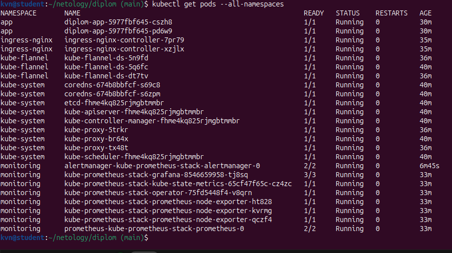
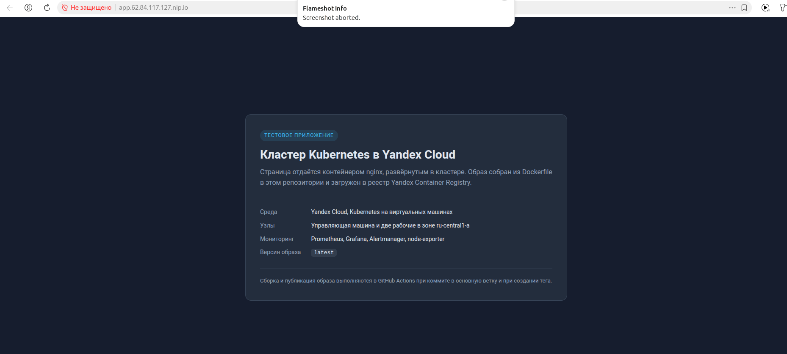

# Дипломный проект: инфраструктура, кластер Kubernetes и CI/CD в Yandex Cloud

Проект разворачивает тестовое приложение в управляемом кластере Kubernetes
Yandex Cloud. Вся инфраструктура описана в Terraform, состояние хранится в
Object Storage, сборка и доставка приложения выполняются в GitHub Actions,
наблюдаемость обеспечивает kube-prometheus-stack.

## Состав решения

| Компонент | Реализация |
|---|---|
| Облачная сеть | VPC с тремя подсетями в зонах `ru-central1-a`, `ru-central1-b`, `ru-central1-d` |
| Кластер | Yandex Managed Service for Kubernetes, региональный мастер |
| Рабочие узлы | три прерываемые виртуальные машины `standard-v3`, 2 ядра, 4 ГБ, доля процессора 50 % |
| Хранилище состояния | бакет Object Storage, backend S3 с версионированием |
| Реестр образов | Yandex Container Registry |
| Приложение | nginx со статической страницей, образ на базе `nginx:1.27-alpine` |
| Входной трафик | ingress-nginx с балансировщиком нагрузки |
| Мониторинг | kube-prometheus-stack: Prometheus, Grafana, Alertmanager, node-exporter, kube-state-metrics |
| CI/CD | GitHub Actions: сборка образа, релиз по тегу, деплой, план Terraform |

Схема взаимодействия компонентов:

```
Пользователь
    |
    v
Балансировщик Yandex Cloud (порт 80)
    |
    v
ingress-nginx (2 реплики, пространство имён ingress-nginx)
    |                                   |
    v                                   v
diplom-app (namespace app)        Grafana (namespace monitoring)
    |
    v
Prometheus, Alertmanager, node-exporter, kube-state-metrics
```

## Структура репозитория

```
.
├── app/                        тестовое приложение и Dockerfile
├── k8s/
│   ├── app/                    Deployment, Service, Ingress, PodDisruptionBudget
│   ├── ingress-nginx/          значения Helm для входного контроллера
│   └── monitoring/             значения Helm для kube-prometheus-stack
├── terraform/
│   ├── bootstrap/              сервисные аккаунты и бакет состояния
│   └── infrastructure/         сеть, кластер, группа узлов, реестр образов
├── scripts/                    развёртывание и удаление ресурсов
├── .github/workflows/          пайплайны приложения и инфраструктуры
├── screenshots/                снимки экрана для отчёта
└── README.md                   отчёт о выполнении
```

## Этап 1. Облачная инфраструктура

Инфраструктура разделена на два каталога. Причина разделения — файл состояния
Terraform нельзя хранить в бакете, который этим же файлом состояния управляет.
Подготовительный этап выполняется один раз с правами администратора каталога,
после чего все дальнейшие изменения применяются от отдельного сервисного
аккаунта.

### Сервисные аккаунты

`terraform/bootstrap` создаёт три сервисных аккаунта с минимально достаточными
ролями:

| Аккаунт | Роли | Назначение |
|---|---|---|
| `diplom-terraform` | `editor`, `storage.admin` | управление ресурсами из Terraform и пайплайна |
| `diplom-k8s-agent` | `k8s.clusters.agent`, `vpc.publicAdmin`, `load-balancer.admin`, `monitoring.editor` | работа мастера кластера: сеть, балансировщик, узлы |
| `diplom-k8s-nodes` | `container-registry.images.puller`, `logging.writer`, `monitoring.editor` | загрузка образов и передача телеметрии с узлов |

Права суперпользователя не используются: роли выданы на уровне каталога и
ограничены перечисленными задачами. Ключ сервисного аккаунта Terraform
сохраняется в `terraform/bootstrap/terraform-sa-key.json` с правами `0600` и
исключён из репозитория.

### Хранилище состояния

`terraform/bootstrap` создаёт бакет с включённым версионированием и закрытым
анонимным доступом. Параметры подключения к нему вынесены в
`terraform/infrastructure/backend.hcl`, который создаётся из
`backend.hcl.example` и не попадает в Git.

```bash
cd terraform/infrastructure
cp terraform.tfvars.example terraform.tfvars
cp backend.hcl.example backend.hcl
```

### Сеть

`terraform/infrastructure/network.tf` создаёт сеть `10.10.0.0/16`, по одной
подсети `/24` в каждой зоне доступности и две группы безопасности. Группа
узлов разрешает SSH, обмен трафиком внутри сети, обращения от балансировщика
по диапазонам проверки состояния `198.18.235.0/24` и `198.18.248.0/24`, а также
исходящие соединения. Группа мастера открывает API-сервер на портах 443 и 6443.

### Применение

```bash
./scripts/deploy.sh bootstrap   # сервисные аккаунты и бакет
./scripts/deploy.sh infra       # сеть, кластер, группа узлов, реестр
```

Скрипты вызывают `terraform init` и `terraform apply` без дополнительных
ручных действий. Удаление выполняется командами:

```bash
./scripts/destroy.sh infra
./scripts/destroy.sh bootstrap
```

Порядок удаления обратный: сначала кластер и сеть, затем бакет, в котором
хранится файл состояния.

Результат применения:


## Этап 2. Кластер Kubernetes

Выбран управляемый сервис Yandex Cloud: мастер и его обслуживание остаются на
стороне провайдера, а усилия направлены на конфигурацию рабочих узлов и
прикладных ресурсов. Мастер региональный, то есть размещён в трёх зонах
доступности одновременно; отказ одной зоны не останавливает управляющий слой.

Вариант с самостоятельной установкой через Ansible и Kubespray не
используется. При таком выборе потребовался бы отдельный репозиторий с
инвентарём, плейбуками и описанием подготовки узлов, а также ручное
обслуживание управляющего слоя и сертификатов.

Параметры кластера:

| Параметр | Значение |
|---|---|
| Версия Kubernetes | 1.31, канал обновлений `STABLE` |
| Сеть подов | `10.100.0.0/16` |
| Сеть сервисов | `10.200.0.0/16` |
| Сетевые политики | Calico |
| Доступ к API | публичный адрес, порты 443 и 6443 |
| Узлы | 3–6, по одной машине в каждой зоне |
| Тип узлов | прерываемые, `standard-v3`, 2 × 4 ГБ, диск 32 ГБ |
| Обновление узлов | автоматическое, с автоматическим восстановлением |

Файл доступа к кластеру записывается в `~/.kube/config` командой:

```bash
yc managed-kubernetes cluster get-credentials diplom-cluster --external --force
```

Проверка кластера:

```bash
kubectl get nodes -o wide
kubectl get pods --all-namespaces
```




## Этап 3. Тестовое приложение

Приложение находится в каталоге `app` и представляет собой статическую
страницу, которую отдаёт nginx. Содержимое:

| Файл | Назначение |
|---|---|
| `app/Dockerfile` | сборка образа, версия передаётся аргументом сборки |
| `app/nginx.conf` | конфигурация сервера, обработчик проверки состояния `/healthz` |
| `app/html/index.html` | страница с описанием стенда и версией образа |

В образе используется `nginx:1.27-alpine`, каталог с содержимым принадлежит
пользователю `nginx`, добавлена проверка работоспособности контейнера.
Версия образа записывается в `/usr/share/nginx/html/version.txt` и
отображается на странице.

Сборка и публикация вручную:

```bash
docker build --build-arg APP_VERSION=v1.0.0 -t cr.yandex/<идентификатор>/diplom-app:v1.0.0 app/
yc container registry configure-docker
docker push cr.yandex/<идентификатор>/diplom-app:v1.0.0
```

Адрес реестра выводится Terraform:

```bash
terraform -chdir=terraform/infrastructure output registry_address
```

В пайплайне образ получает две метки: неизменяемую (`sha-<первые 7 символов
коммита>` либо `v1.0.0` для тега) и `latest` для основной ветки и релизов.
Неизменяемая метка позволяет вернуться к предыдущей версии и однозначно
определить, из какого коммита собран образ.



## Этап 4. Мониторинг и развёртывание приложения

### Входной контроллер

`ingress-nginx` устанавливается в отдельное пространство имён и создаёт
сервис типа `LoadBalancer`, для которого Yandex Cloud выделяет внешний адрес.
Контроллер работает в двух репликах, реплики распределяются по зонам
доступности, метрики передаются в Prometheus через `ServiceMonitor`.

```bash
helm repo add ingress-nginx https://kubernetes.github.io/ingress-nginx
helm upgrade --install ingress-nginx ingress-nginx/ingress-nginx \
  --namespace ingress-nginx --create-namespace \
  --values k8s/ingress-nginx/values.yaml --wait
```

### Система мониторинга

Используется пакет `kube-prometheus-stack`: он содержит Prometheus Operator,
Prometheus, Alertmanager, Grafana, node-exporter и kube-state-metrics, а также
набор правил и панелей для кластера. Значения Helm находятся в
`k8s/monitoring/kube-prometheus-values.yaml`.

| Параметр | Значение |
|---|---|
| Хранение метрик | 24 часа, ограничение 4 ГБ |
| Сбор метрик | ServiceMonitor, PodMonitor, правила Prometheus Operator |
| Панели | наборы для кластера и узлов, Grafana подключает их автоматически |
| Alertmanager | маршрут по умолчанию, правила подавления для критичных оповещений |
| Пароль Grafana | Secret `grafana-admin`, создаётся из переменной `GRAFANA_PASSWORD` |
| Компоненты управляющего слоя | задания etcd, kube-scheduler, kube-controller-manager отключены: доступ к ним закрыт провайдером |

```bash
helm repo add prometheus-community https://prometheus-community.github.io/helm-charts
GRAFANA_HOST="grafana.<внешний IP>.nip.io" \
  envsubst '${GRAFANA_HOST}' < k8s/monitoring/kube-prometheus-values.yaml \
  | helm upgrade --install kube-prometheus-stack \
      prometheus-community/kube-prometheus-stack \
      --namespace monitoring --create-namespace \
      --values - --wait
```

Доступ к Grafana открыт по HTTP на 80 порту через тот же контроллер:

```bash
kubectl -n ingress-nginx get service ingress-nginx-controller
kubectl -n monitoring get ingress
```

Пример подключения получателя оповещений (Telegram) приведён в
`k8s/monitoring/alertmanager-notification.example.yaml`. Токен и идентификатор
чата передаются через Secret.

### Приложение в кластере

Манифесты находятся в `k8s/app`:

| Файл | Содержание |
|---|---|
| `deployment.yaml` | две реплики, проверки готовности и работоспособности, ограничения ресурсов, запрет повышения привилегий, корневая файловая система только для чтения |
| `service.yaml` | внутренний сервис на порту 80 |
| `ingress.yaml` | публикация через контроллер, ограничение размера запроса |
| `pdb.yaml` | бюджет прерывания: минимум одна доступная реплика при обслуживании узлов |

Реплики распределяются по зонам доступности через `topologySpreadConstraints`,
поэтому обслуживание одной зоны не останавливает приложение.

```bash
./scripts/deploy.sh app
kubectl -n app get deployment,pods,service,ingress
```

Адреса после развёртывания:

| Ресурс | Адрес |
|---|---|
| Приложение | `http://app.<внешний IP>.nip.io/` |
| Grafana | `http://grafana.<внешний IP>.nip.io/` |
| Prometheus | `kubectl port-forward -n monitoring svc/kube-prometheus-stack-prometheus 9090:9090` |
| Alertmanager | `kubectl port-forward -n monitoring svc/kube-prometheus-stack-alertmanager 9093:9093` |

Схема `<адрес>.nip.io` выбрана, чтобы не заводить собственный домен: имя
преобразуется в IP автоматически.


## Этап 5. Terraform в пайплайне

Отдельный пайплайн `.github/workflows/terraform.yml` запускается при изменении
файлов в каталоге `terraform` и вручную. Он заменяет Terraform Cloud и
Atlantis: план строится для каждого pull request и публикуется комментарием,
применение выполняется только при слиянии в `main`.

```yaml
- terraform fmt -check -recursive
- terraform validate
- terraform plan -out=tfplan
- terraform apply -auto-approve tfplan   # только для ветки main
```

Параметры хранилища состояния передаются в `terraform init` через файл,
который создаётся в рабочем каталоге агента из секретов. Ключ сервисного
аккаунта также создаётся на время выполнения и удаляется в завершающем шаге.


## Этап 6. CI/CD приложения

Пайплайн `.github/workflows/app-ci.yml` содержит две задачи.

**Сборка.** Запускается при коммите в `main`, при создании тега и в pull
request:

1. определяется метка образа: `sha-<7 символов>` для коммита, имя тега для релиза;
2. выполняется вход в Yandex Container Registry под ключом сервисного аккаунта;
3. образ собирается с кэшированием слоёв через GitHub Actions;
4. при создании тега и коммите в `main` дополнительно обновляется метка `latest`;
5. в pull request образ собирается без публикации и проверяется запуском
   контейнера: запрос к `/healthz` и наличие заголовка страницы.

**Развёртывание.** Выполняется после успешной сборки при коммите в `main` и
при создании тега:

1. файл доступа к кластеру восстанавливается из секрета `KUBE_CONFIG_B64`;
2. командой `kubectl set image` обновляется образ в Deployment;
3. ожидается завершение обновления с ограничением по времени;
4. выводятся состояние подов и список Ingress.

Релиз выполняется созданием тега:

```bash
git tag v1.0.0
git push origin v1.0.0
```

В результате в реестре появляется образ `diplom-app:v1.0.0`, а кластер
переводится на него.

### Секреты репозитория

| Секрет | Назначение |
|---|---|
| `YC_SA_KEY` | ключ сервисного аккаунта в формате JSON |
| `YC_REGISTRY_ID` | идентификатор реестра образов |
| `YC_CLOUD_ID`, `YC_FOLDER_ID` | параметры каталога для Terraform |
| `TF_BACKEND_ACCESS_KEY`, `TF_BACKEND_SECRET_KEY` | доступ к бакету состояния |
| `TF_STATE_BUCKET` | имя бакета состояния |
| `KUBE_CONFIG_B64` | файл доступа к кластеру в кодировке base64 |

Значения секретов в репозиторий не добавляются. Ключ с правами `editor`
целесообразно заменить на отдельный аккаунт с правами только на публикацию
образов, если пайплайн используется за пределами учебного проекта.


## Проверка результата

```bash
# Кластер доступен, узлы в состоянии Ready
kubectl get nodes

# Все системные поды запущены
kubectl get pods --all-namespaces

# Приложение отвечает
curl -I http://app.<внешний IP>.nip.io/
curl http://app.<внешний IP>.nip.io/healthz

# Мониторинг собирает метрики
kubectl -n monitoring get prometheus,alertmanager,servicemonitor
kubectl -n monitoring port-forward svc/kube-prometheus-stack-prometheus 9090:9090
```

Проверка отказоустойчивости: удаление пода приложения приводит к созданию
нового, страница остаётся доступной, потому что вторая реплика продолжает
работу. Бюджет прерывания гарантирует, что при обслуживании узлов хотя бы одна
реплика остаётся доступной.

```bash
kubectl -n app delete pod -l app.kubernetes.io/name=diplom-app --wait=false
kubectl -n app get pods -w
```

## Экономия ресурсов

Ограничения бюджета учтены следующими решениями:

- прерываемые виртуальные машины для рабочих узлов;
- доля процессора 50 % и диски 32 ГБ;
- отсутствие отдельного шлюза NAT: узлы имеют публичные адреса;
- хранение метрик на диске узла с ограничением 4 ГБ вместо заказа отдельного
  диска;
- отключение сбора метрик с компонентов управляющего слоя, недоступных в
  управляемом сервисе;
- автоматическое масштабирование группы узлов от 3 до 6 машин.

После завершения работы ресурсы удаляются командами из раздела первого этапа.
Кластер и балансировщик — основные статьи расходов, поэтому их удаление
выполняется в первую очередь.

## Файлы проекта

| Файл | Назначение |
|---|---|
| [terraform/bootstrap/main.tf](terraform/bootstrap/main.tf) | сервисные аккаунты, роли, ключ, бакет состояния |
| [terraform/infrastructure/network.tf](terraform/infrastructure/network.tf) | сеть, подсети, группы безопасности |
| [terraform/infrastructure/kubernetes.tf](terraform/infrastructure/kubernetes.tf) | региональный мастер и группа узлов |
| [terraform/infrastructure/registry.tf](terraform/infrastructure/registry.tf) | реестр образов и права на загрузку |
| [app/Dockerfile](app/Dockerfile) | образ тестового приложения |
| [k8s/app/deployment.yaml](k8s/app/deployment.yaml) | Deployment приложения |
| [k8s/app/ingress.yaml](k8s/app/ingress.yaml) | публикация приложения |
| [k8s/monitoring/kube-prometheus-values.yaml](k8s/monitoring/kube-prometheus-values.yaml) | параметры мониторинга |
| [k8s/ingress-nginx/values.yaml](k8s/ingress-nginx/values.yaml) | параметры входного контроллера |
| [.github/workflows/app-ci.yml](.github/workflows/app-ci.yml) | сборка, публикация и деплой приложения |
| [.github/workflows/terraform.yml](.github/workflows/terraform.yml) | план и применение инфраструктуры |
| [scripts/deploy.sh](scripts/deploy.sh) | последовательное развёртывание |
| [scripts/destroy.sh](scripts/destroy.sh) | удаление ресурсов |

